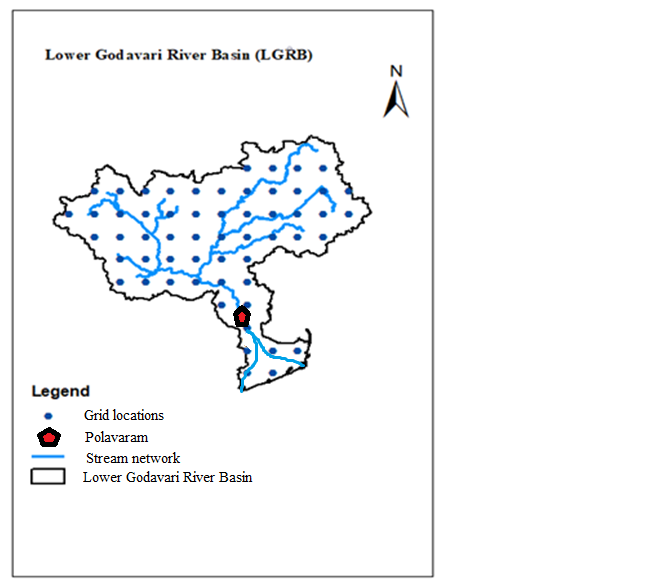

All of these are on [GitHub](https://github.com/aakashbansalgit/), each with its code and results.

## [NVIX and volatility](https://github.com/aakashbansalgit/nvix-volatility-channels)

Which kinds of front-page news predict stock market volatility, 1926 to 2016. The news measure was fitted to implied volatility over 1996 to 2009, so every claim is tested on the windows the text model never saw.

## [Joint SPX and VIX calibration with a neural SDE](https://github.com/aakashbansalgit/spx-vix-neural-sde)

From a J.P. Morgan-sponsored practicum: a neural stochastic volatility model fitted to SPX options, VIX options and VIX futures at once. My part was how the fit is judged and trained: bid-ask coverage and deviation metrics, dynamic loss weights and warm-started recalibration.

## [Agency MBS prepayment](https://github.com/aakashbansalgit/agency-mbs-prepayment)

Prepayment speeds, credit stratification and loss severity on Fannie Mae loan performance data. When rates dipped in September 2024, loans from early 2023 over $400k went from 7.6% CPR in July to 16.0% in October, while loans from early 2022 did not move.

## [Heston calibration](https://github.com/aakashbansalgit/heston-calibration)

A Heston pricer checked against Black-Scholes, adaptive quadrature and Monte Carlo, and calibrated to 1,434 live SPX option quotes.

## [Forecasting the VIX](https://github.com/aakashbansalgit/ml-in-finance)

Walk-forward forecasts one day and one month ahead. A three-term HAR regression beats a random forest and a neural network a month out.

## [Option pricing in C++](https://github.com/aakashbansalgit/cpp-option-pricing) and [by PDE](https://github.com/aakashbansalgit/pde-option-pricer)

Barrier options by Monte Carlo with a Brownian-bridge correction and variance reduction, trinomial trees with Richardson extrapolation, and a Crank-Nicolson solver for European, American and barrier options with a convergence study.

## More

[Linear programs in finance](https://github.com/aakashbansalgit/lp-finance), [ARMA-GARCH models of S&P 500 volatility](https://github.com/aakashbansalgit/time-series-econometrics), [defensive allocation for the Cornell case competition](https://github.com/aakashbansalgit/cornell-case-competition) and [a sector signal backtest](https://github.com/aakashbansalgit/sector-signal-backtest).

# Earlier work

## [Rainfall & Runoff Prediction Using Advanced Neural Networks](https://github.com/aakashbansalgit/MATLAB)

This project focused on optimizing Wavelet Neural Network (WNN) and Long Short-Term Memory (LSTM) models to predict rainfall and runoff patterns in the Lower Godavari Basin. Historical time-series data such as temperature, humidity, longitude, and latitude were leveraged to enhance model accuracy. A Graphical User Interface (GUI) was developed to simplify the interaction and implementation of both models, paving the way for future research in hydrological forecasting.

## [Portfolio Optimization Using Monte Carlo Simulation](https://colab.research.google.com/drive/1LKKB4yoGEodjFldARHUXsm00OMfm4VQ7?usp=sharing)

This project aimed to identify the Markowitz optimal return by employing Monte Carlo Simulation techniques. Using Python, portfolio optimization techniques were applied to balance risk and return, providing actionable investment strategies for diverse market scenarios.

## [Hidden Markov Model for Risk and Return Prediction](https://colab.research.google.com/drive/18sHAwOSy6eqa_je0hpfOpTlwV6wsXms2?usp=sharing)

In this project, Hidden Markov Models (HMM) were developed using the Python hmmlearn library to predict financial returns and Value at Risk (VaR). The HMM framework enabled capturing the probabilistic transitions of market states, offering valuable insights for strategic financial decision-making.

## Revenue Forecasting & Risk Analysis

This project involved forecasting revenue growth for a dataset with over 4,000 features. Techniques such as Stochastic Gradient Descent, advanced optimization, and hyperparameter tuning were employed using Python libraries like JAX and Optax. The project also explored Hidden Markov Models for predicting returns and calculating Value at Risk, alongside Monte Carlo Simulation for portfolio optimization and risk analysis.

## Comprehensive Business Risk Evaluation

A robust analysis of business risks, including systematic and unsystematic risks, was conducted to evaluate financial, operational, and total leverage for competitor firms. Using financial models and simulations, the project aimed to interpret optimal capital structures for publicly traded stocks. This comprehensive approach provided actionable insights into business dynamics and capital strategy.

